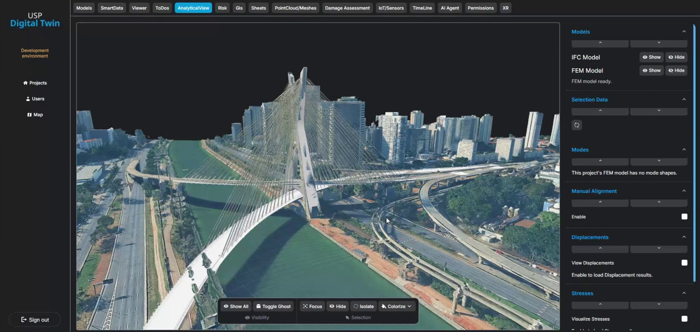
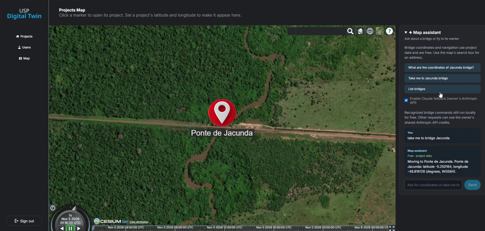
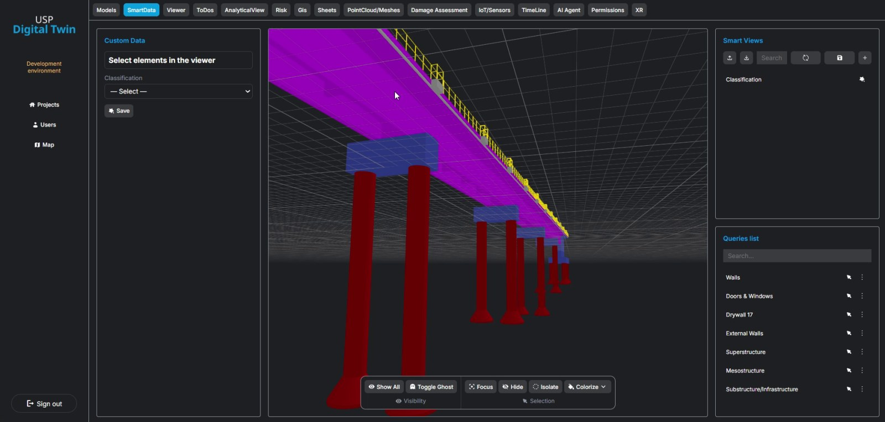
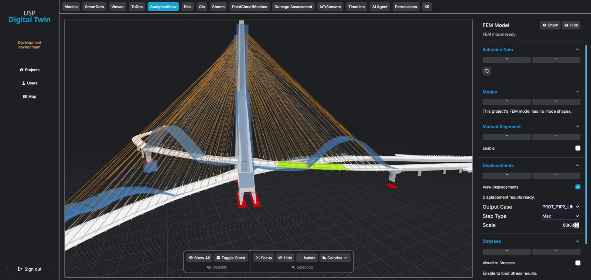
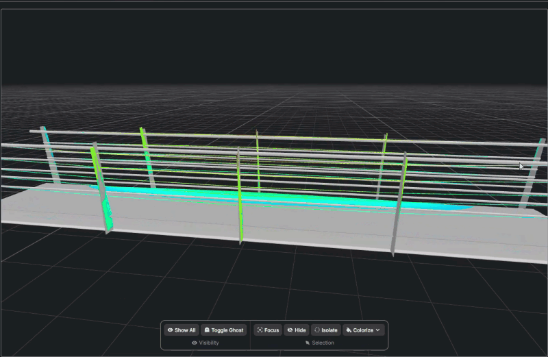
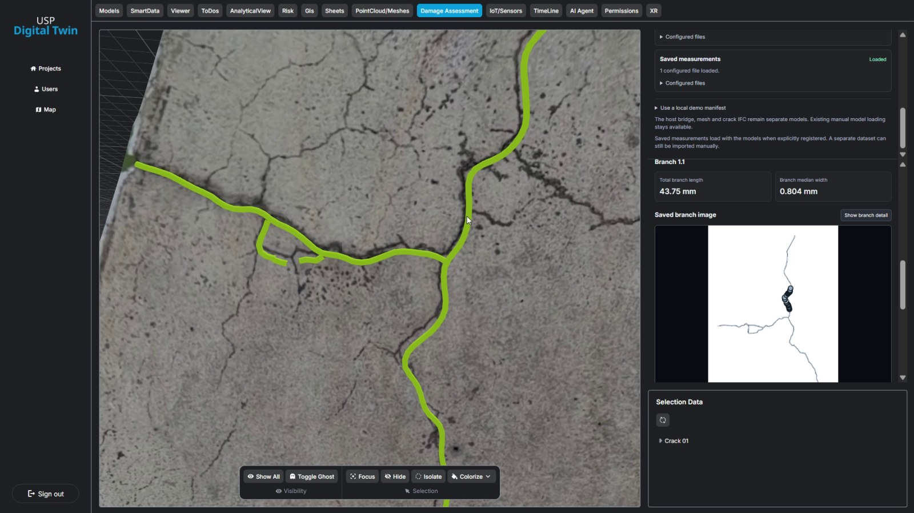
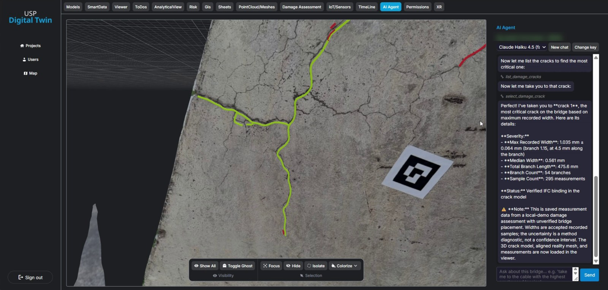
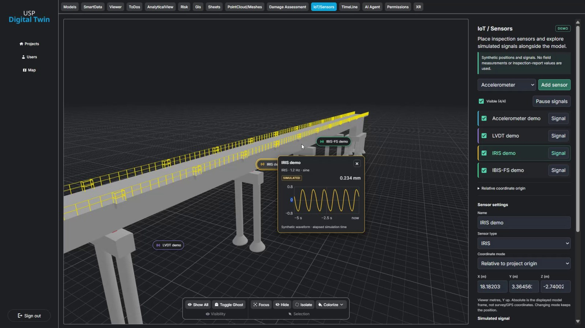
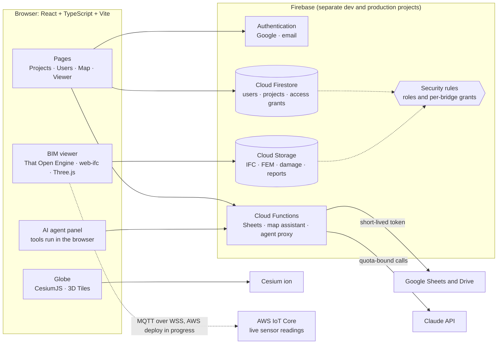

# USP Digital Twin Platform: a case study

A web platform that puts everything known about a bridge in one place: its BIM model, structural analysis results, inspection reports, measured damage, deterioration forecasts and sensors, all shown on the structure itself and on a 3D globe.

I designed and built it as lead developer in the research groups GMEC and LabInfra at the Escola Politécnica da Universidade de São Paulo (Poli-USP), as part of my PhD. The source code lives in a private repository of the lab's GitHub organization. This repository explains what the platform does, how it is built and why it is built that way.

> **Resumo em português.** Plataforma web de gêmeo digital para pontes, desenvolvida no GMEC e no LabInfra (Poli-USP) durante o meu doutorado. Reúne o modelo BIM (IFC), os resultados de análise estrutural (deslocamentos, tensões e modos de vibração), os relatórios de inspeção, as fissuras medidas, as previsões de deterioração e os sensores, sobre a própria estrutura e num globo 3D, com controle de acesso por ponte. O código é privado; este repositório apresenta o projeto, a arquitetura e as decisões técnicas.

*The Octávio Frias de Oliveira bridge in São Paulo: its IFC and finite-element models georeferenced on Google Photorealistic 3D Tiles, streamed through Cesium.*

## At a glance

| | |
| --- | --- |
| **My role** | Lead developer: architecture, front end, Firebase back end, security rules, CI and documentation |
| **Context** | PhD research at GMEC and LabInfra, Poli-USP, supervised by Prof. Túlio Nogueira Bittencourt |
| **Period** | October 2024 to today |
| **Front end** | React 18, TypeScript, Vite, That Open Engine (IFC, Fragments, web-ifc, Three.js), CesiumJS, 3D Tiles, Chart.js |
| **Back end** | Firebase: Authentication, Cloud Firestore, Cloud Storage, Cloud Functions (2nd gen, Node.js), Hosting |
| **Integrations** | Google Sheets and Drive APIs, Anthropic Claude API, Model Context Protocol (MCP) |
| **Quality** | GitHub Actions on every pull request: type checks, lint, about 60 offline test files, security-rules tests on local emulators |

## The problem

The information about a bridge is scattered across many tools and file formats:

- the BIM model (IFC) that describes the geometry and the elements;
- finite-element models in CSiBridge or ANSYS, with their displacements, stresses and vibration modes;
- inspection reports, usually long PDFs;
- crack measurements produced offline by an image-processing pipeline;
- deterioration forecasts for each element;
- sensor readings.

An engineer who wants to answer "how is this beam doing?" has to open several programs and match the results by hand. Inspection reports and damage data are also sensitive, so each bridge needs its own access rules.

The platform brings these sources together on the structure itself, in the browser, with no software to install.

## What the platform does

### Bridge portfolio on a 3D globe

The **Map** page shows every bridge in the catalog on a CesiumJS globe. A **map assistant** answers common requests ("list the bridges", "take me to the Jacundá bridge") with a small rule-based parser that runs in the browser and costs nothing: the answer above is marked *Free · project data*. Only requests it does not recognize can go, after the user agrees, to an optional Claude fallback that runs in a Cloud Function with strict quotas. A separate local **MCP server** lets a desktop assistant such as Claude Desktop drive the same map tab through three tools.

### BIM viewer and custom data

Each project opens a viewer built on That Open Engine. It loads IFC and Fragments models and shows each element's properties. Users can add **custom properties** that the IFC file does not have, such as superstructure, mesostructure and infrastructure, then color, select or isolate elements by any property (**Smart Views** and queries). The **GIS layers** place the models at their real coordinates on satellite imagery and 3D tiles, and the viewer also loads meshes (OBJ), such as a textured mesh built from smartphone photos of the bridge.

### Structural analysis results

  
  

*Left: displacements of the Octávio Frias bridge from CSiBridge, exaggerated by a chosen scale. Right: stresses on the Jacundá bridge for a selected load combination and stress component.*

*A torsion mode of the Poli-USP footbridge, computed in ANSYS, animating in the viewer.*

The **AnalyticalView** panel shows a bridge's finite-element model next to its IFC model, with or without the IFC visible. For the two CSiBridge models it plots displacements and stresses by load case or combination, step type and stress component. For the ANSYS model of the footbridge it lists each vibration mode with its frequency and an automatic label, and animates the chosen shape with an adjustable amplitude. ANSYS results are converted offline into one solver-independent file, `modal-model.json`, so the viewer does not depend on any solver.

### Damage assessment

The **Damage Assessment** panel shows the cracks measured by the lab's offline image-processing pipeline on a textured mesh of the surface. For each crack network the user can select a branch and read its length, its median width, its saved image and each recorded width sample, with the measurement's provenance and uncertainty. Measurements appear only when the selected model and IFC element match a reviewed dataset binding, and each bridge declares its own assets in an explicit manifest, so the viewer never guesses files or loads another bridge's data.

### Deterioration risk

The **Risk** panel links each IFC element to its deterioration forecast: the probability of each damage condition (DC 1 to DC 5) as the bridge ages, over a forecast horizon the user chooses, next to the element's current age and condition.

### Inspection reports and per-bridge permissions

Administrators grant registered Viewers access to one bridge's inspection reports, its damage data, or both, independently. A grant only allows reading: it never allows uploading, editing or managing the project.

### AI agent inside the viewer

An optional agent panel uses Claude with tool use. Its 11 tools let it read the project overview, list and select finite-element members, list and highlight IFC categories, show or hide models, read inspection-report PDFs, and load and select measured cracks. Asked to "take me to the most critical crack", it loads the bridge's damage models, ranks the cracks by maximum recorded width and selects the worst one in the viewer. Asked to "take me to the cable with the highest tension", it finds that cable in the CSiBridge results and highlights it.

The tools run in the browser, because they act on the live viewer, and every read they make goes through the security rules. The model calls go through an authenticated Cloud Function, so the browser never holds an Anthropic key. On every round the function adds the system prompt and the fixed tool catalog, rechecks the user's report and damage grants for that bridge, and charges per-user and per-project quotas. It also writes an audit log entry without the question or the answer.

### Google Sheets

A Google Sheet can drive the model: each row maps an IFC category to an action (highlight the beams, hide the columns, isolate the slabs). The platform can also write back, for example a new worksheet with the element count of each category. Callable Cloud Functions do the reading and writing with short-lived tokens, without any downloaded key (see [Security and governance](#security-and-governance)).

### IoT and sensors

*Sensor markers on the Jacundá bridge, shown here with synthetic demo signals.*

The **IoT/Sensors** tab places editable accelerometer, LVDT and other sensor markers on the model and opens a signal chart beside each one. Each sensor takes its data from one of two sources: synthetic signals, which the panel labels as such, or a live MQTT feed.

Live ingestion was merged into the main branch in November 2026:

- The browser subscribes to one topic per sensor over MQTT on secure WebSockets. It checks every message against a versioned contract (the unit for each sensor type, a sensor ID that matches the topic, timestamps, a size limit) and drops duplicates.
- Each card and marker shows the sensor's state: live, stale (judged by the reading's own timestamp), reconnecting, offline or not authorized. Reconnection backs off with jitter and pauses while the browser is offline.
- A dam demo adds piezometer, inclinometer and reservoir-level sensors, fed by a device simulator.
- On AWS IoT Core, a custom authorizer checks the user's Firebase ID token and grants subscribe-only access. Devices connect with X.509 certificates and may publish only to their own site's topics. Readings are stored in DynamoDB and expire after 30 days.

It has been tested end to end in the app with a local broker; the AWS deployment is in progress.

### Projects, tasks and users

React pages manage projects, to-dos tied to model elements, and user accounts and roles.

## Architecture

More diagrams (viewer composition, access control, the keyless Sheets flow and the release pipeline) are in [docs/architecture.md](docs/architecture.md).

## Security and governance

Inspection reports and damage data belong to bridge owners and must not leak between projects, so access control gets the same attention as the features.

- **Separate environments.** Development and production are two Firebase projects with their own accounts, roles and data. Builds refuse to start with missing values or with identifiers from both projects mixed together.
- **The rules are the boundary, not the interface.** Two app roles, Administrator and Viewer, are stored in each user's profile and enforced by Firestore and Storage security rules. Hiding a button is never the only protection.
- **Least privilege per bridge.** Report access and damage access are granted separately for each bridge, and neither allows uploads or edits.
- **Rules are tested.** Every pull request runs the security rules against local emulators with synthetic users, so a permissions regression fails CI before it reaches any environment.
- **No long-lived keys for Google APIs.** The Sheets functions impersonate a dedicated service account with short-lived tokens, a different one in each environment, and they check that the account belongs to the same project before asking for credentials.
- **Controlled AI costs and data exposure.** Both Claude features call the model only from Cloud Functions, for signed-in users. The provider key stays in Secret Manager, never in the browser. Each function has a fixed model allowlist and per-user and per-project limits, counted atomically in Firestore. The map assistant sends the provider only the question and bridge names. The viewer agent's function rechecks the user's per-bridge grants on every round and logs each request without its content.
- **Narrow local integrations.** The MCP server listens only on the loopback interface, accepts an exact list of origins and hosts, and pairs with one map tab through a random code.
- **Safe data operations.** The scripts that copy bridge data from production to development show a preview by default and never copy accounts or roles.

## Engineering practice

- **Continuous integration.** GitHub Actions runs three jobs on every pull request: the application (type checks, lint, offline regression tests, the MCP server build, the production build and a Python adapter test), the Cloud Functions build, and the security-rules tests.
- **Short branches and reviewed releases.** Changes go through focused pull requests, then a shared development deployment and browser checks, then a production release in a fixed order: rules, then Functions, then Hosting.
- **Documentation next to the code.** Each feature has a design note covering its data, its limits and how to verify it: sensors, damage assessment, FEM models, map security, deployment, users and authentication.

## Key decisions

| Decision | Why |
| --- | --- |
| Firebase instead of a custom server | A small research team gets authentication, a database, file storage and hosting without running servers, and the security rules give one testable place to enforce access. |
| That Open Engine and CesiumJS | Open-source tools that handle IFC models and the globe in the browser, with no plug-ins or licenses for users. |
| One solver-independent modal file | Converting ANSYS and CSi results into `modal-model.json` keeps the viewer independent of the analysis software. |
| Explicit asset manifests | Each bridge lists its own files, so the viewer never searches folders or shows one bridge's data on another. |
| Free rule-based path before any model call | Common map requests cost nothing and work without an API key; the language model is an optional, capped fallback. |
| A server-side proxy for the viewer agent | The browser never holds a provider key, and the server enforces quotas, per-bridge grants and an audit log. The agent's tools stay in the browser because they act on the live viewer. |
| Keyless service-account access | Short-lived impersonated tokens replace downloaded JSON keys, so there is no long-lived secret to leak or rotate. |

## Roadmap

- **Live sensors in production.** Finish the AWS deployment and its end-to-end check, then connect real instruments in place of the simulator.
- **BCF.** Turn the to-dos, which already link an element to a problem, into BCF issues with the camera position and a picture of the damage, for exchange with other BIM tools.
- **Browser tests.** End-to-end tests with Playwright on an isolated emulator project: loading a real IFC, restoring a to-do highlight, switching projects without stale state.

## Credits

Developed at the Escola Politécnica da USP under the supervision of Prof. Túlio Nogueira Bittencourt, in two research groups:

- [GMEC](https://sites.usp.br/gmec/), Grupo de Modelagem de Estruturas de Concreto;
- [LabInfra](https://sites.usp.br/labinfra/), Laboratório de Ensaios, Inspeção, Manutenção, Monitoramento e Análise de Obras de Infraestrutura.

Built with [That Open Engine](https://thatopen.com/), [CesiumJS](https://cesium.com/platform/cesiumjs/), [Firebase](https://firebase.google.com/), [React](https://react.dev/) and [Vite](https://vite.dev/). 3D city context from Google Photorealistic 3D Tiles; map imagery through Cesium ion.

## About the code

The source code is private and belongs to the lab. I am happy to walk through it, or show the recorded demos, in an interview or on request.

Felipe da Silva Brandão · [Portfolio](https://felipe-brandao-portfolio.web.app)
