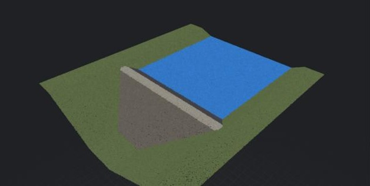
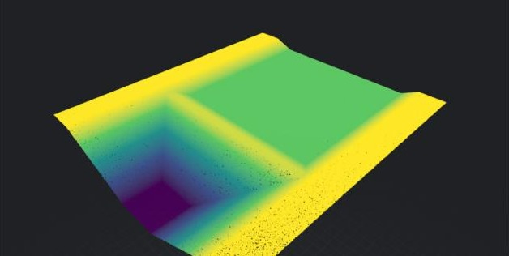
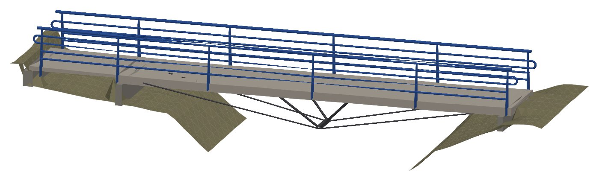
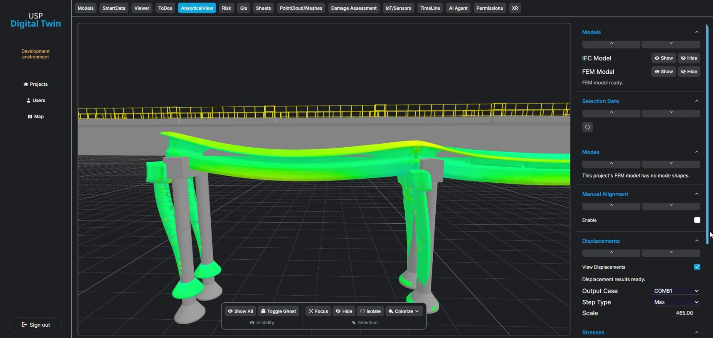
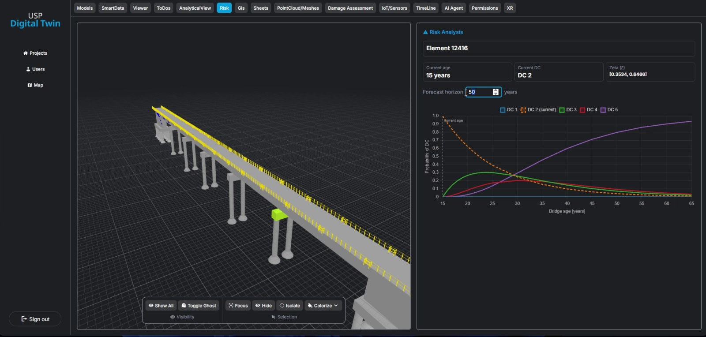
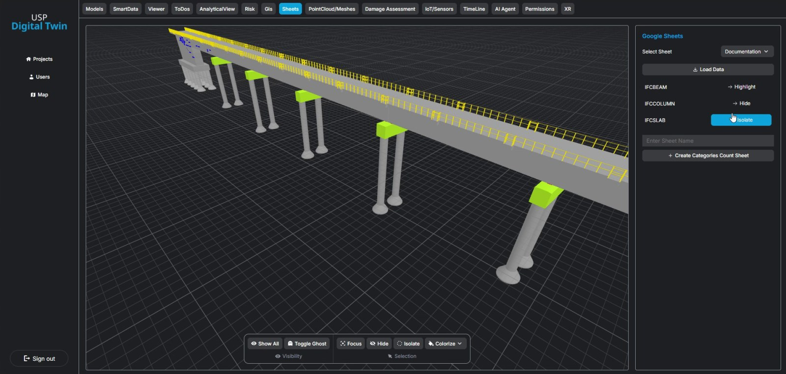
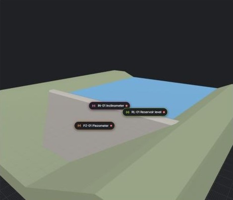
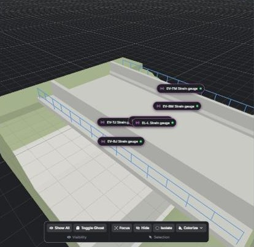
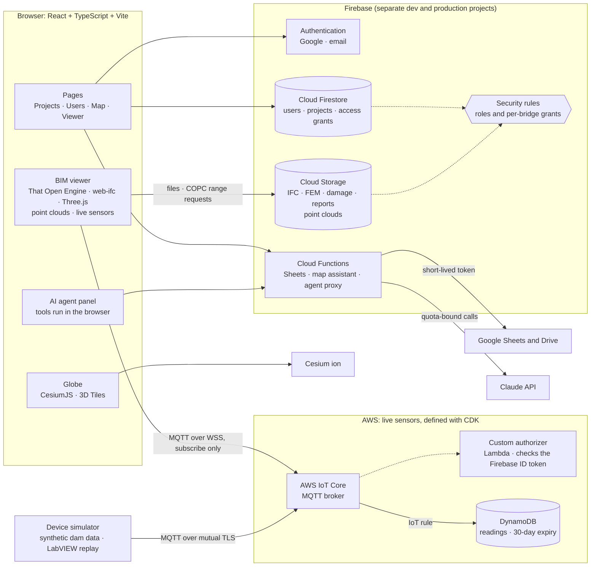

# USP Digital Twin Platform: a case study

A web platform that puts everything known about a bridge in one place: its BIM model, laser scans and point clouds, structural analysis results, inspection reports, measured damage, deterioration forecasts and sensors, all shown on the structure itself and on a 3D globe.

I designed and built it as lead developer in the research groups GMEC and LabInfra at the Escola Politécnica da Universidade de São Paulo (Poli-USP), as part of my PhD. The source code lives in a private repository of the lab's GitHub organization. This repository explains what the platform does, how it is built and why it is built that way.

> **Resumo em português.** Plataforma web de gêmeo digital para pontes, desenvolvida no GMEC e no LabInfra (Poli-USP) durante o meu doutorado. Reúne o modelo BIM (IFC), os resultados de análise estrutural (deslocamentos, tensões e modos de vibração), os relatórios de inspeção, as fissuras medidas, as previsões de deterioração e os sensores, sobre a própria estrutura e num globo 3D, com controle de acesso por ponte. Também importa nuvens de pontos de escaneamento a laser e de NeRF, com streaming COPC por nível de detalhe, e traz modelos IFC de duas pontes do campus, gerados por script: a Ponte de Minas, a partir do escaneamento a laser, e a Ponte da Mecânica, com seus extensômetros modelados como IfcSensor. Recebe leituras de sensores por MQTT via AWS IoT Core, fluxo validado em ambiente de desenvolvimento com dados simulados, e reproduz, com o mesmo contrato de mensagens, dados de extensômetros registrados no LabVIEW, que, em teste, já passaram pelo AWS IoT Core e foram armazenados no DynamoDB. O código é privado; este repositório apresenta o projeto, a arquitetura e as decisões técnicas.

*The Octávio Frias de Oliveira bridge in São Paulo: its IFC and finite-element models georeferenced on Google Photorealistic 3D Tiles, streamed through Cesium.*

## At a glance

| | |
| --- | --- |
| **My role** | Lead developer: architecture, front end, Firebase back end, AWS IoT pipeline, security rules, CI and documentation |
| **Context** | PhD research at GMEC and LabInfra, Poli-USP, supervised by Prof. Túlio Nogueira Bittencourt |
| **Period** | October 2024 to today |
| **Front end** | React 18, TypeScript, Vite, That Open Engine (IFC, Fragments, web-ifc, Three.js), CesiumJS, 3D Tiles, Chart.js, MQTT.js for live sensors, copc.js and laz-perf (WebAssembly) for point clouds |
| **Back end** | Firebase: Authentication, Cloud Firestore, Cloud Storage, Cloud Functions (2nd gen, Node.js), Hosting. AWS IoT Core, Lambda and DynamoDB for live sensors, defined with AWS CDK |
| **Integrations** | Google Sheets and Drive APIs, Anthropic Claude API, Model Context Protocol (MCP), MQTT |
| **Tooling** | Python (IfcOpenShell for scripted IFC models, npTDMS for LabVIEW exports), a C# .NET 8 device simulator (MQTTnet) |
| **Quality** | GitHub Actions on every pull request and push to main, in four jobs that run type checks, lint, builds and more than 1,500 automated tests (offline, security rules on local emulators, C# simulator, Python tools) |

## The problem

The information about a bridge is scattered across many tools and file formats:

- the BIM model (IFC) that describes the geometry and the elements;
- laser scans and point clouds from photogrammetry or NeRF reconstructions;
- finite-element models in CSiBridge or ANSYS, with their displacements, stresses and vibration modes;
- inspection reports, usually long PDFs;
- crack measurements produced offline by an image-processing pipeline;
- deterioration forecasts for each element;
- sensor readings.

An engineer who wants to answer "how is this beam doing?" has to open several programs and match the results by hand. Inspection reports and damage data are also sensitive, so each bridge needs its own access rules.

The platform brings these sources together on the structure itself, in the browser, with no software to install.

## What the platform does

### Bridge portfolio on a 3D globe

The **Map** page shows every bridge in the catalog on a CesiumJS globe. A **map assistant** answers common requests ("list the bridges", "take me to the Jacundá bridge") with a small rule-based parser that runs in the browser and costs nothing: the answer above is marked *Free · project data*. Only requests it does not recognize can go, after the user agrees, to an optional Claude fallback that runs in a Cloud Function with strict quotas. A separate local **MCP server** lets a desktop assistant such as Claude Desktop drive the same map tab through three tools.

### BIM viewer and custom data

Each project opens a viewer built on That Open Engine. It loads IFC and Fragments models and shows each element's properties. Users can add **custom properties** that the IFC file does not have, such as superstructure, mesostructure and infrastructure, then color, select or isolate elements by any property (**Smart Views** and queries). The **GIS layers** place the models at their real coordinates on satellite imagery and 3D tiles, and the viewer also loads point clouds and meshes (OBJ), such as a textured mesh built from smartphone photos of the bridge.

### Point clouds

  
  

*A simulated drone LiDAR scan of the demo dam (synthetic data, used for testing), colored by RGB (left) and by height (right).*

The **PointCloud/Meshes** panel imports laser scans in the browser: PLY, LAS and LAZ, XYZ/TXT/CSV and Leica PTS. Every reader takes the file in 8 MiB slices, so no file is held whole as one JavaScript buffer (LAZ is the exception: its WebAssembly decoder needs the whole compressed file, up to 1 GiB), and large scans are thinned evenly to a point budget the user picks (5 million points by default). Coordinates far from the origin get a global shift that is put back in double precision, so millimeters survive the GPU's single precision. The user can color a cloud by RGB, intensity or height, and a Toggle Grid button hides the ground grid when it gets in the way. E57 and Leica's own formats are not read in the browser; the panel asks for an export to LAS, LAZ or PTS instead.

Scans too big to load whole are opened as **COPC** (Cloud Optimized Point Cloud) files and streamed by level of detail. The viewer reads the octree index with HTTP range requests, picks the nodes the camera can resolve within the point budget, as Potree does, and decodes them in two Web Workers with laz-perf. A COPC saved to the project streams straight from Cloud Storage, with no tile server. On a synthetic 200-million-point scan, measured on a laptop, the view was ready to orbit within 5 seconds from cloud storage and orbiting took about 9 to 12 ms per frame (median). A plain import of a 50-million-point file from local disk, thinned to 16.7 million points, took 13 seconds to load and about 32 ms per frame.

Clouds are placed in the IFC model's coordinates and are not registered automatically: a cloud must already be in the model's frame, and then it lands on the model with no transform. Administrators can save a cloud to the project, and users reopen it from the panel's saved list. Point-cloud support is merged and checked in the development environment; it is not yet in production.

### Bridge models from scans and drawings

*The as-built IFC model of Ponte de Minas, generated from LabInfra's laser scan (render of the IFC file).*

Two bridges on the USP campus now have IFC models generated by Python scripts with IfcOpenShell. Every value has a recorded source, and the files are reproducible and checked (see [Engineering practice](#engineering-practice)), so a change to a model can be reviewed like code.

- **Ponte de Minas**, a small footbridge over a drainage channel, has an as-built model taken from LabInfra's laser scan: deck slabs lofted through cross-sections of the scan, support walls, pipe railings on plate posts, the underslung king-post truss and the scanned banks. Its 27 elements carry property sets, quantities, materials and an as-built property set that records how each value was measured. The laser scan is the only geometric reference, because the NeRF and photogrammetry clouds of the same bridge are what the lab's comparison study evaluates. Its checker also measures how far each surface is from the scan: the steel members and the deck show median distances from a few millimeters to about a centimeter, and the walls and terrain differ more, mostly on faces the scanner could not see.
- **Ponte da Mecânica**, a short concrete road bridge, is generated from the lab's inspection drawing and cross-checked member by member against the original design drawing; its concrete volume agrees with the design quantity to within a few percent. The six strain gauges the lab installed on it are IfcSensor elements on the member and face the lab's records give (the exact position along the span is assumed at mid-span). Each is tagged with its gauge ID, which is also its replay channel's name, and holds its host member, face and measuring direction. The design note separates what the sources settle from what was assumed.

The Ponte de Minas model sits in the scanner's own frame, so its laser cloud overlays it with no transform. So does a NeRF cloud of about 30 million points, reconstructed from mobile-phone images and registered to the laser frame before import (aligned by hand, then refined with a rigid point-to-plane ICP); converted to COPC, which keeps every point's position and color exactly and drops only normals the viewer does not use, it is 8.6 times smaller than the original LAS file and streams from storage. Either cloud can be colored or hidden, to compare the low-cost capture with the laser scanner on the same model. Both bridge models use local coordinates and are not georeferenced, so they open in the viewer, not on the globe. Their elements sit directly in the IfcSite, so that the viewer's importer keeps them in its spatial tree. Each bridge has its own project in the development environment.

### Structural analysis results

  
  

*Left: displacements of the Octávio Frias bridge from CSiBridge, exaggerated by a chosen scale. Right: stresses on the Jacundá bridge for a selected load combination and stress component.*

*A torsion mode of the Poli-USP footbridge, computed in ANSYS, animating in the viewer.*

The **AnalyticalView** panel shows a bridge's finite-element model next to its IFC model, with or without the IFC visible. For the two CSiBridge models it plots displacements and stresses by load case or combination, step type and stress component. For the ANSYS model of the footbridge it lists each vibration mode with its frequency and an automatic label, and animates the chosen shape with an adjustable amplitude. ANSYS results are converted offline into one solver-independent file, `modal-model.json`, so the viewer does not depend on any solver.

### Damage assessment

The **Damage Assessment** panel shows the cracks measured by the lab's offline image-processing pipeline on a textured mesh of the surface. For each crack network the user can select a branch and read its length, its median width, its saved image and each recorded width sample, with the measurement's provenance and uncertainty. Measurements appear only when the selected model and IFC element match a reviewed dataset binding, and each bridge declares its own assets in an explicit manifest, so the viewer never guesses files or loads another bridge's data.

### Deterioration risk

The **Risk** panel links each IFC element to its deterioration forecast: the probability of each damage condition (DC 1 to DC 5) as the bridge ages, over a forecast horizon the user chooses, next to the element's current age and condition.

### Inspection reports and per-bridge permissions

Administrators grant registered Viewers access to one bridge's inspection reports, its damage data, or both, independently. A grant only allows reading: it never allows uploading, editing or managing the project.

### AI agent inside the viewer

An optional agent panel uses Claude with tool use. Its 11 tools let it read the project overview, list and select finite-element members, list and highlight IFC categories, show or hide models, read inspection-report PDFs, and load and select measured cracks. Asked to "take me to the most critical crack", it loads the bridge's damage models, ranks the cracks by maximum recorded width and selects the worst one in the viewer. Asked to "take me to the cable with the highest tension", it finds that cable in the CSiBridge results and highlights it.

The tools run in the browser, because they act on the live viewer, and every read they make goes through the security rules. The model calls go through an authenticated Cloud Function, so the browser never holds an Anthropic key. On every round the function adds the system prompt and the fixed tool catalog, rechecks the user's report and damage grants for that bridge, and charges per-user and per-project quotas. It also writes an audit log entry without the question or the answer.

### Google Sheets

A Google Sheet can drive the model: each row maps an IFC category to an action (highlight the beams, hide the columns, isolate the slabs). The platform can also write back, for example a new worksheet with the element count of each category. Callable Cloud Functions do the reading and writing with short-lived tokens, without any downloaded key (see [Security and governance](#security-and-governance)).

### IoT and sensors

*Sensor markers on the Jacundá bridge, shown here with synthetic demo signals.*

The **IoT/Sensors** tab places editable sensor markers on the model (accelerometers, LVDTs, strain gauges, piezometers, inclinometers, reservoir level and others) and opens a signal chart beside each one. Each sensor takes its data from one of two sources: synthetic signals, which the panel labels as such, or a live MQTT feed.

Live ingestion was merged into the main branch in November 2026:

- The browser subscribes to one topic per sensor over MQTT on secure WebSockets. It checks every message against a versioned contract (the unit for each sensor type, a sensor ID that matches the topic, timestamps, a size limit) and drops duplicates.
- Each card and marker shows the sensor's state: live, stale (judged by the reading's own timestamp), reconnecting, offline or not authorized. Reconnection backs off with jitter and pauses while the browser is offline.
- A dam demo adds piezometer, inclinometer and reservoir-level sensors, fed by a device simulator written in C#. No public dam IFC with a license that allows adding sensors was found, so a script generates a fictitious earth-rockfill dam with a clay core, using IFC 4.3 earthworks classes, with the three instruments as IfcSensor elements at the simulator's elevations. Its geometry is illustrative, not design data, and the demo puts its markers on those IfcSensor points.
- On AWS IoT Core, a custom authorizer checks the user's Firebase ID token and grants subscribe-only access. Devices connect with X.509 certificates and may publish only to their own site's topics. Readings are stored in DynamoDB and expire after 30 days; the QoS, outbox and storage details are in [docs/architecture.md](docs/architecture.md#live-sensors).

It is verified end to end on AWS IoT Core in the development environment with simulated data: the simulator publishes over mutual TLS, an IoT rule stores the readings in DynamoDB, and the viewer, signed in with Firebase, shows the sensors as live. It is not yet connected to real instruments.

**Recorded lab data through the same pipeline.** The lab's wireless datalogger on Ponte da Mecânica has recorded its six strain gauges in LabVIEW TDMS files since 2021. A Python export reduces each channel to one value per time window (mean, minimum, maximum or the larger excursion), can zero each channel to remove the gauges' offsets, flags a channel as suspect when its gauge circuit reports a low excitation voltage, and writes a replay file and a manifest. The simulator then plays the rows back over MQTT under the same contract as a field device, re-stamped at playback time and optionally sped up, and each card shows the reading's quality flag. In IoT/Sensors the manifest is read in the browser, and with the Ponte da Mecânica model loaded each channel lands on the IfcSensor with the same tag. A tag shared by two elements is ignored, so a channel never lands on the wrong gauge. The raw recordings stay on the local computer and the panel uploads nothing; only the downsampled readings travel over MQTT. Through a local MQTT broker, the replayed channels show live on the Ponte da Mecânica gauges. Through AWS IoT Core, the bridge has its own device certificate and topics, a test replay at four times real speed kept up, and its readings were stored in DynamoDB, where they expire after 30 days; the viewer's live view of that path is still to be checked. To keep up over the long round trip to the AWS region, the simulator lets up to 16 readings await acknowledgement at once, at most one per sensor, so each sensor's readings stay in order.

  
  

*Left: the fictitious dam generated for the live-sensor demo, with its three instrument markers (not connected to a broker in this capture). Right: the Ponte da Mecânica model with recorded strain data played back through a local broker; each channel sits on the IfcSensor gauge with the same tag.*

### Projects, tasks and users

React pages manage projects, to-dos tied to model elements, and user accounts and roles.

## Architecture

More diagrams (viewer composition, access control, the live-sensor pipeline, the keyless Sheets flow and the release pipeline) are in [docs/architecture.md](docs/architecture.md).

## Security and governance

Inspection reports and damage data belong to bridge owners and must not leak between projects, so access control gets the same attention as the features.

- **Separate environments.** Development and production are two Firebase projects with their own accounts, roles and data. Builds refuse to start with missing values or with identifiers from both projects mixed together.
- **The rules are the boundary, not the interface.** Two app roles, Administrator and Viewer, are stored in each user's profile and enforced by Firestore and Storage security rules. Hiding a button is never the only protection.
- **Least privilege per bridge.** Report access and damage access are granted separately for each bridge, and neither allows uploads or edits.
- **Rules are tested.** Every pull request and every push to main runs the security rules (137 tests) against local emulators with synthetic users, so a permissions regression fails CI before it reaches any environment.
- **Live sensors without device secrets in the browser.** The viewer is subscribe-only and sends the user's Firebase token only to the broker configured at build time. The custom authorizer checks the token's signature, issuer, audience and expiry, rejects unverified accounts, keeps each user in a client-ID namespace of their own and explicitly denies publishing. Per-bridge authorization of sensor feeds is still to come: today every verified user can read every configured site, which includes the replayed Ponte da Mecânica data as well as the synthetic dam.
- **No long-lived keys for Google APIs.** The Sheets functions impersonate a dedicated service account with short-lived tokens, a different one in each environment, and they check that the account belongs to the same project before asking for credentials.
- **Controlled AI costs and data exposure.** Both Claude features call the model only from Cloud Functions, for signed-in users. The provider key stays in Secret Manager, never in the browser. Each function has a fixed model allowlist and per-user and per-project limits, counted atomically in Firestore. The map assistant sends the provider only the question and bridge names. The viewer agent's function rechecks the user's per-bridge grants on every round and logs each request without its content.
- **Narrow local integrations.** The MCP server listens only on the loopback interface, accepts an exact list of origins and hosts, and pairs with one map tab through a random code.
- **Safe data operations.** The scripts that copy bridge data from production to development show a preview by default and never copy accounts or roles. Lab recordings stay out of the code: the LabVIEW export refuses to write inside a Git repository, and recorded files are ignored by Git.

## Engineering practice

- **Continuous integration.** GitHub Actions runs four jobs on every pull request, every push to main and on demand: the application (type checks, lint with zero warnings, about 1,400 offline tests, the MCP server build, the production build, a check that the offline damage preview bundles no live Firebase, and a Python adapter test); the Cloud Functions build; the IoT job (C# tests of the device simulator, tests of the LabVIEW export on synthetic files only, and a type check and synthesis of the AWS CDK stack without credentials); and the security-rules tests. The workflow has read-only access to the repository and uses no cloud credentials or secrets.
- **Short branches and reviewed releases.** Changes go through focused pull requests, then a shared development deployment and browser checks, then a production release in a fixed order: rules, then Functions, then Hosting. After each Hosting deploy the checklist verifies the cache headers, so a browser runs a new release on its next page load (deployed to development so far).
- **Reproducible models.** The dam and bridge IFC models are generated by scripts with pinned dependencies and fixed identifiers, so every rebuild is byte-identical, and a checker validates the schema and every element.
- **Documentation next to the code.** Each feature has a design note covering its data, its limits and how to verify it. There are 18, among them sensors, the AWS IoT Core setup, the live-demo runbook, the LabVIEW replay, point clouds, the dam and bridge models, damage assessment, FEM models, map security, deployment, and users and authentication.

## Key decisions

| Decision | Why |
| --- | --- |
| Firebase instead of a custom server | A small research team gets authentication, a database, file storage and hosting without running servers, and the security rules give one testable place to enforce access. |
| That Open Engine and CesiumJS | Open-source tools that handle IFC models and the globe in the browser, with no plug-ins or licenses for users. |
| One solver-independent modal file | Converting ANSYS and CSi results into `modal-model.json` keeps the viewer independent of the analysis software. |
| Explicit asset manifests | Each bridge lists its own files, so the viewer never searches folders or shows one bridge's data on another. |
| Free rule-based path before any model call | Common map requests cost nothing and work without an API key; the language model is an optional, capped fallback. |
| A server-side proxy for the viewer agent | The browser never holds a provider key, and the server enforces quotas, per-bridge grants and an audit log. The agent's tools stay in the browser because they act on the live viewer. |
| Keyless service-account access | Short-lived impersonated tokens replace downloaded JSON keys, so there is no long-lived secret to leak or rotate. |
| Replay recorded lab data through the live pipeline | Recorded strain data takes the same path and message contract a field device would, so the contract checks, the stale logic and the placement on IfcSensor gauges are exercised on recorded lab signals before any instrument is connected. Downsampling at the edge keeps message volume low, and the raw recordings stay local. |
| Stream very large scans as COPC | One file per scan in the existing cloud storage, read with HTTP range requests and decoded with the LAZ decoder the viewer already ships. Potree needs thousands of files per scan and a separate viewer or a custom loader, and 3D Tiles' relative paths break with storage download URLs. |

## Roadmap

- **Real instruments.** Recorded strain data from the lab's datalogger already plays back onto the Ponte da Mecânica gauges through a local broker, and through AWS IoT Core into DynamoDB (the viewer's live view of the AWS path is still to be checked). Next come a direct, continuous feed from the instruments, authorization of sensor sites from the per-bridge permissions, and history charts from the stored readings (today the charts show a rolling two-minute window).
- **Point-cloud tools.** Eye-dome lighting and adaptive point size for streamed clouds, point picking and measurements, and clipping boxes.
- **BCF.** Turn the to-dos, which already link an element to a problem, into BCF issues with the camera position and a picture of the damage, for exchange with other BIM tools.
- **Browser tests.** End-to-end tests with Playwright on an isolated emulator project: loading a real IFC, restoring a to-do highlight, switching projects without stale state.

## Credits

Developed at the Escola Politécnica da USP under the supervision of Prof. Túlio Nogueira Bittencourt, in two research groups:

- [GMEC](https://sites.usp.br/gmec/), Grupo de Modelagem de Estruturas de Concreto;
- [LabInfra](https://sites.usp.br/labinfra/), Laboratório de Ensaios, Inspeção, Manutenção, Monitoramento e Análise de Obras de Infraestrutura.

Built with [That Open Engine](https://thatopen.com/), [CesiumJS](https://cesium.com/platform/cesiumjs/), [Firebase](https://firebase.google.com/), [React](https://react.dev/), [Vite](https://vite.dev/), [IfcOpenShell](https://ifcopenshell.org/) and [AWS IoT Core](https://aws.amazon.com/iot-core/). 3D city context from Google Photorealistic 3D Tiles; map imagery through Cesium ion.

## About the code

The source code is private and belongs to the lab. I am happy to walk through it, or show the recorded demos, in an interview or on request.

Felipe da Silva Brandão · [Portfolio](https://felipe-brandao-portfolio.web.app)
