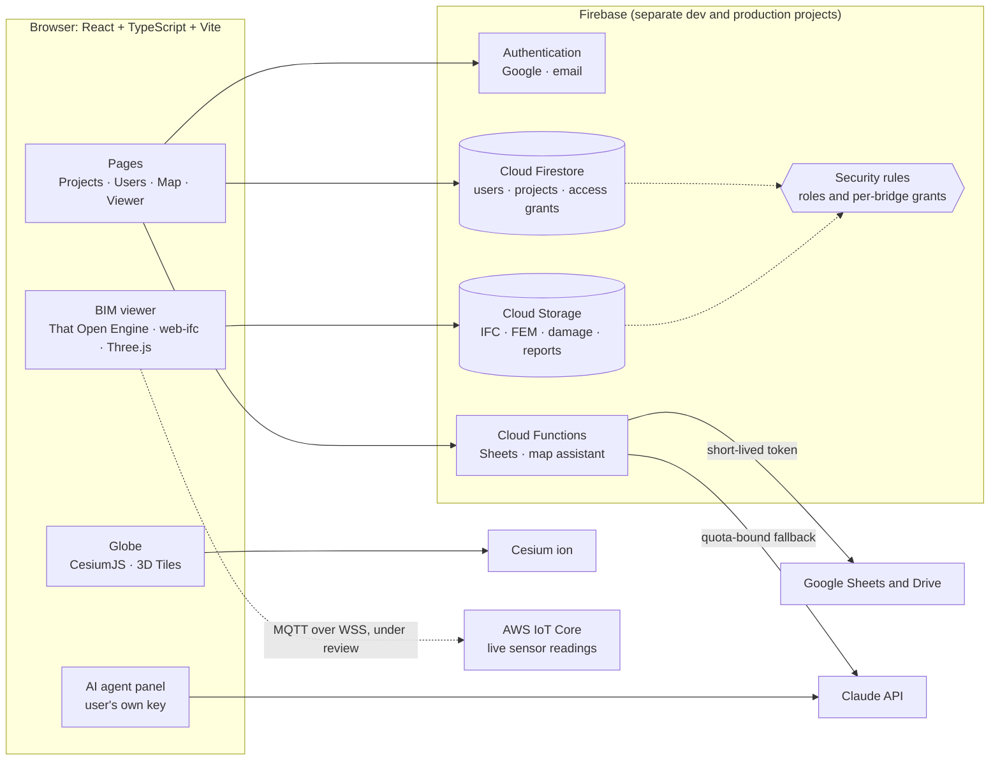
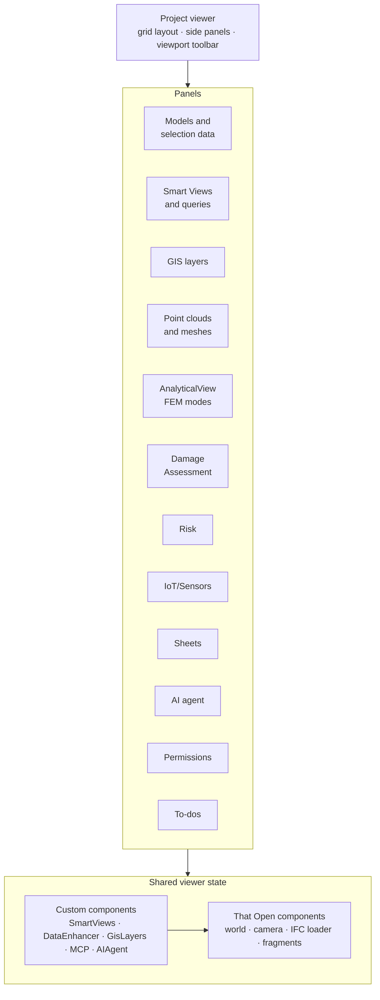
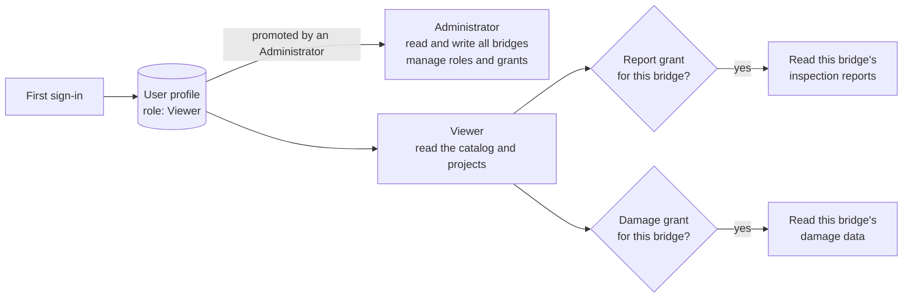
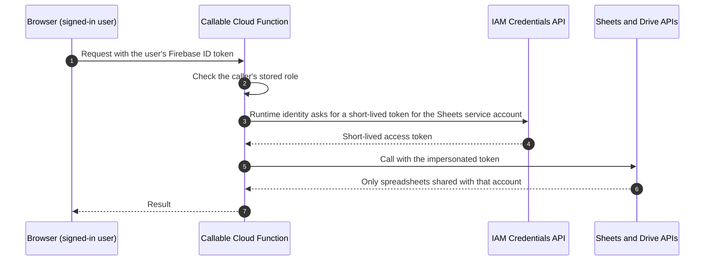
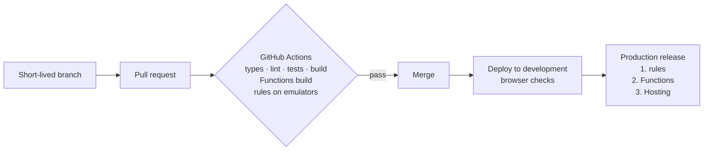

# Architecture

This page expands the overview diagram in the [README](../README.md#architecture). It covers how the viewer is put together, how access is controlled, how the back end reaches Google Sheets without a stored key, and how a change travels to production.

## System overview

The browser talks to Firebase directly. Firestore and Storage requests are checked by the security rules, so the rules, not the interface, decide what each user can read or write. Cloud Functions handle the work that needs server-side identity: calling Google APIs and the optional Claude fallback of the map assistant. The viewer's AI agent calls Claude straight from the browser with the user's own key. The dashed link is the live-sensor feed, still under review: the viewer subscribes to AWS IoT Core with the user's Firebase ID token, and the broker grants subscribe-only access.

## Viewer composition

Every panel works on the same That Open world, so a selection made in one panel (an IFC element, a FEM element, a crack) is the selection the others see. Custom components extend That Open Engine for the lab's needs: coloring by query, joining external data to IFC elements, placing the model on GIS layers, and exposing viewer actions to the AI agent and the MCP server. Panels clean up after themselves: the sensors overlay, for example, disposes its markers, animation callback and event listeners when the user switches projects.

## Access control

- A new account always starts as a Viewer. The rules trust only the role already stored in the profile, never a role sent with a request.
- Report and damage grants are separate records per bridge and per user. Neither allows uploads, edits or project administration, and a grant for one bridge says nothing about another.
- Storage follows the same model: each bridge's files sit under their own path, and its damage files require that bridge's damage grant.
- The rules are tested on every pull request against local Firestore and Storage emulators with synthetic users.

## Google Sheets without a stored key

The function never holds a downloaded key. Its runtime identity has permission to create tokens for one dedicated service account in the same project, and the function refuses an account from any other project. Signing in to the app with Google does not expose the user's own Drive: the app reaches only the spreadsheets explicitly shared with the service account.

## From a change to production

A merged pull request does not publish anything. Hosting, rules and Functions each have their own explicit deployment command per environment, and production releases follow a fixed order so that the security rules are always in place before the code that depends on them.
