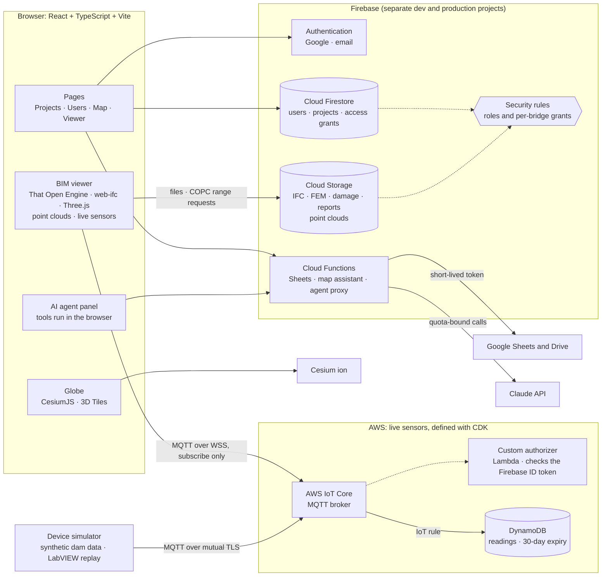
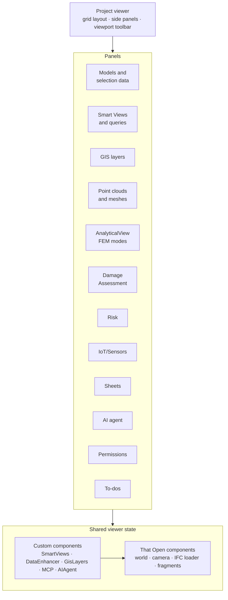
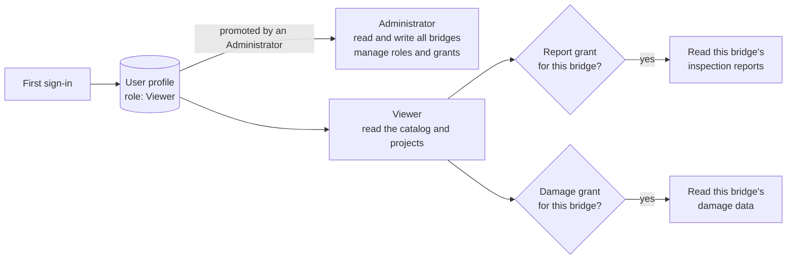
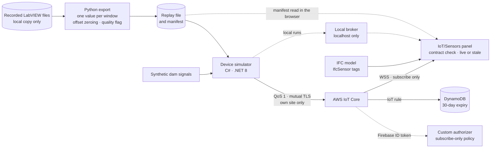
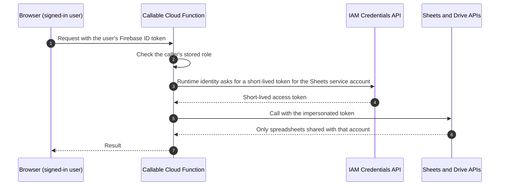
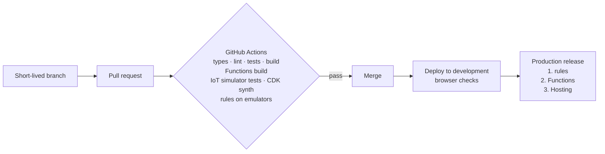

# Architecture

This page expands the overview diagram in the [README](../README.md#architecture). It covers how the viewer is put together, how access is controlled, how sensor readings reach the viewer, how the back end reaches Google Sheets without a stored key, and how a change travels to production.

## System overview

The browser talks to Firebase directly. Firestore and Storage requests are checked by the security rules, so the rules, not the interface, decide what each user can read or write. Cloud Functions handle the work that needs server-side identity: calling Google APIs, and the Claude calls of both the map assistant and the viewer's AI agent, so no provider key reaches the browser. The agent's tools still run in the browser, because they act on the live viewer. Large point clouds can be saved as single COPC files in Cloud Storage, and the viewer reads only the parts it needs with HTTP range requests. For live sensor readings, the viewer subscribes to AWS IoT Core with the user's Firebase ID token, and a custom authorizer grants subscribe-only access; the AWS side is described below.

## Viewer composition

Every panel works on the same That Open world, so a selection made in one panel (an IFC element, a FEM element, a crack) is the selection the others see. Custom components extend That Open Engine for the lab's needs: coloring by query, joining external data to IFC elements, placing the model on GIS layers, and exposing viewer actions to the AI agent and the MCP server. Panels clean up after themselves: the sensors overlay, for example, disposes its markers, animation callback and event listeners when the user switches projects.

## Access control

- A new account always starts as a Viewer. The rules trust only the role already stored in the profile, never a role sent with a request.
- Report and damage grants are separate records per bridge and per user. Neither allows uploads, edits or project administration, and a grant for one bridge says nothing about another.
- Storage follows the same model: each bridge's files sit under their own path, and its damage files require that bridge's damage grant.
- The rules are tested on every pull request and every push to main against local Firestore and Storage emulators with synthetic users.

## Live sensors

- **Two kinds of source, one contract.** The C# device simulator publishes either synthetic dam signals or a replay of recorded lab data. Both reach the viewer under the same versioned message contract (unit per sensor type, a sensor ID that matches the topic, timestamps, at most 4 KB), so the viewer handles a replay exactly as it handles a device. Replayed readings are re-stamped at playback time and keep the recording's spacing, compressed by the chosen speed.
- **Devices.** Each device has its own X.509 certificate, may connect only under its own name and may publish only to its site's telemetry and its own status topic. It publishes at QoS 1 from a bounded store-and-forward outbox, so a reading leaves the outbox only after the broker acknowledges it. Up to 16 readings can await acknowledgement at once, at most one per sensor, so each sensor stays in order while a distant broker still receives several readings per round trip. A retained status with a last will marks it online or offline.
- **Viewers.** The browser connects over secure WebSockets with the user's Firebase ID token. A custom authorizer checks the token and returns a policy that allows subscribing to the configured sites and explicitly denies publishing. The viewer judges staleness by the device's timestamp, so a backlog flushed after an outage shows as stale, not live.
- **Storage.** An IoT rule writes one DynamoDB item per reading, keyed by site, instrument and device timestamp, so a QoS 1 redelivery overwrites instead of duplicating. Items expire after 30 days, and point-in-time recovery is on.
- **Placement.** Replay channels are placed on the IfcSensor elements of the loaded model whose tag matches the channel; a tag shared by two elements is ignored, and unmatched channels fall back to placeholder positions.
- **Why a custom authorizer.** A Cognito identity pool federated with Firebase would mean two identity systems and request signing in the browser; a token-vending Cloud Function would need AWS credentials and a signing key to manage. The authorizer keeps one identity system and only an MQTT client in the browser.

The pipeline is defined as code with AWS CDK and verified end to end on AWS IoT Core in the development environment with the simulator's synthetic data. Recorded lab data played back through the local broker shows live on the model's IfcSensor gauges. Through AWS IoT Core, where the bridge is a second site with its own device certificate, a test replay at four times real speed kept up and its readings landed in DynamoDB; the viewer's live view of that path has not been checked yet. No real instrument is connected yet.

## Google Sheets without a stored key

The function never holds a downloaded key. Its runtime identity has permission to create tokens for one dedicated service account in the same project, and the function refuses an account from any other project. Signing in to the app with Google does not expose the user's own Drive: the app reaches only the spreadsheets explicitly shared with the service account.

## From a change to production

A merged pull request does not publish anything. Hosting, rules and Functions each have their own explicit deployment command per environment, and production releases follow a fixed order so that the security rules are always in place before the code that depends on them.
